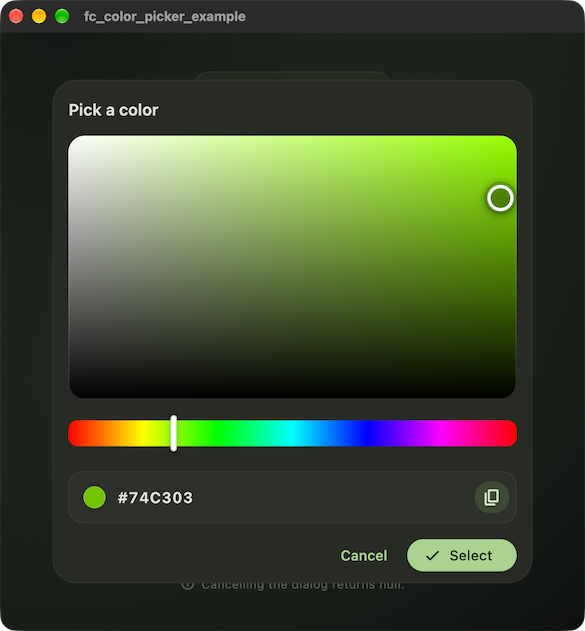

# fc_color_picker

[](https://pub.dev/packages/fc_color_picker)

A Material-based color picker for Flutter.



## Usage

Call `fcPickColor` from any widget and use the returned `Color?`:

```dart
Future<void> _chooseColor() async {
  final color = await fcPickColor(
    context,
    initialColor: _selectedColor,
  );

  if (!mounted || color == null) {
    return; // The user cancelled or dismissed the dialog.
  }

  setState(() => _selectedColor = color);
}
```

### API

```dart
Future<Color?> fcPickColor(
  BuildContext context, {
  Color? initialColor,
  FcColorPickerStrings strings = FcColorPickerStrings.english,
  bool barrierDismissible = true,
})
```

| Parameter            | Default                        | Description                                        |
| -------------------- | ------------------------------ | -------------------------------------------------- |
| `initialColor`       | fresh green                    | The color selected when the dialog opens.          |
| `strings`            | `FcColorPickerStrings.english` | All visible UI strings and tooltips in the dialog. |
| `barrierDismissible` | `true`                         | Whether tapping outside the dialog closes it.      |

### Localization

```dart
final color = await fcPickColor(
  context,
  initialColor: _selectedColor,
  strings: const FcColorPickerStrings(
    title: 'Farbe wählen',
    cancel: 'Abbrechen',
    select: 'Übernehmen',
    copy: 'Kopieren',
  ),
);
```
